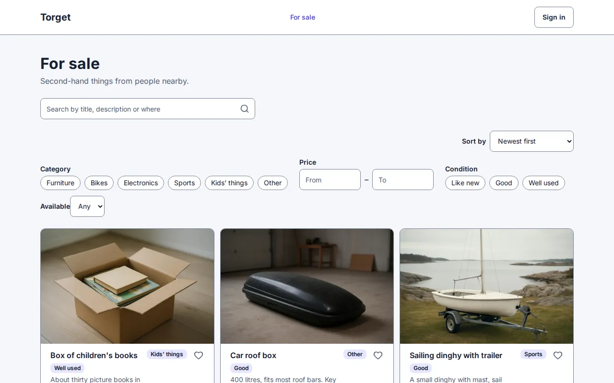

<h1 align="center">
  <picture>
    <source media="(prefers-color-scheme: dark)" srcset="docs/site/brand/wordmark-dark.svg">
    
  </picture>
</h1>

<p align="center"><em>Soft to change. Hard as steel.</em></p>

<p align="center">
  <a href="https://github.com/smithable/smithable/actions/workflows/ci.yml?query=branch%3Amain"></a>
  <a href="https://www.npmjs.com/package/smithable"></a>
  <a href="LICENSE"></a>
  
</p>

Smithable is an app builder for people who have never written code and for developers who want to move faster. You describe a web application in plain language or through a visual editor. Smithable turns it into a compact, technology-neutral specification, `smithable.yml`, and generates an ordinary full-stack web application from it.

The difference from prompt-to-code builders: **Smithable understands the application.** Routine changes are made by deterministic generators, not by an AI rewriting code. Adding a phone number to customers is one operation, in milliseconds, for no tokens; a request that needs interpretation goes to the cheapest capable model with a small slice of the spec. A supported change is checked, migrated with the records kept, tested and can be undone; most cost nothing (in the [M7 benchmark](docs/benchmarks/m7-report.md), one CRM, one run per setup), and the generated code stays clean enough for a developer to take over. Why this matters and who it is for: [docs/VISION.md](docs/VISION.md).

**Status:** beta. The engine, CLI, Studio and MCP server in this repository work on their own, on your machine, with no account. The hosted service (smithable.ai, a private beta) lives in a separate repository and builds on them: we can run it, but it's all yours.

**Documentation:** [docs.smithable.ai](https://docs.smithable.ai): [getting started](https://docs.smithable.ai/start.html), [the eight starters](https://docs.smithable.ai/starters.html), [changing an app without code](https://docs.smithable.ai/change.html), [running an app on your own machine](https://docs.smithable.ai/self-host.html) and the [spec reference](https://docs.smithable.ai/spec.html).



## What a generated app is

A [TanStack Start](https://tanstack.com/start) app with React, Tailwind, shadcn/ui, [Drizzle](https://orm.drizzle.team) and SQLite, written the way a developer who knows that stack would write it. It has no dependency on Smithable at build time or run time, ships as a container with a `/data` volume, carries its own tests, and can be detached at any time.

## Try it

Node 24, then:

```sh
npm install -g smithable                        # or run any command once with npx smithable@latest
smithable --version                             # smithable 0.1.0 (spec 0.1)
smithable new my-crm                            # a CRM from the starter, with sample data
smithable new torget --starter marketplace      # or booking, invoicing, records, status, api
smithable new dogs --describe "a site to show my dogs"   # up to three questions, then a draft (needs a model, docs/ai.md)
smithable new cafe --from https://example.com            # a page as the description; --with-pictures takes its pictures
cd my-crm && smithable studio                   # the editor (No code and Code modes) in the browser
```

From inside a project, the everyday commands:

```sh
smithable op addField Customer taxId string     # a deterministic change: spec, migration, forms, tables
smithable ask "Customers should have a website" # in your own words; confirmed before it applies
smithable undo                                  # takes back the last change, database included
smithable mcp                                   # the same operations as tools for Claude Code, Cursor, …
smithable deploy --target docker                # release checks, then the container
```

To work on Smithable itself, from a clone: `pnpm install`, `pnpm build`, then `node packages/cli/dist/bin.js` in place of `smithable` ([CONTRIBUTING.md](CONTRIBUTING.md)).

The eight starters, with pictures: [docs.smithable.ai/starters](https://docs.smithable.ai/starters.html). `smithable --help` lists everything. Models for `ask`, `code` and `teach` are set up with environment variables: [docs/ai.md](docs/ai.md). `deploy`, `security --level release` and the container tests need Docker; [running an app on your own machine](https://docs.smithable.ai/self-host.html) covers deploying, backups and updates.

## The repository

| Path | What it is |
|---|---|
| `packages/core` | The engine: spec schema, parser, validator, IR, operations, plugin interface. Runs in the browser and Node |
| `packages/adapter-tanstack` | The generator for the TanStack stack, and the app kit it copies into apps |
| `packages/index` | The implementation index, the context builder for AI, the plain-language summary |
| `packages/ai` | Model providers, the AI policy, requests to operations |
| `packages/cli` | The `smithable` command, the Studio server, the MCP server, deploy and backup targets |
| `packages/create-smithable` | `npm create smithable`, which starts an app with `smithable new` (on npm, like the other packages) |
| `apps/studio` | The editor, No code and Code modes (Builder and Studio in the code), one web app served by `smithable studio` |
| `examples/` | The starters: a CRM, a booking site, an invoicing app, a marketplace (Torget), records (things and what we know about them), and a status page |
| `docs/` | The pages of [docs.smithable.ai](https://docs.smithable.ai) (`docs/site/`), [vision](docs/VISION.md), [architecture](docs/ARCHITECTURE.md), [roadmap](docs/ROADMAP.md), the [spec reference](docs/spec/v0.1.md), [AI setup](docs/ai.md), [how things were built and measured](docs/as-built.md), benchmarks and research |

## Working on it

`pnpm check` is the gate: lint, build, unit tests, then every example generated, type-checked, built, served and regenerated, and Studio driven in a real browser. Before a change to the engine, the examples or the scripts it runs, run it locally through `scripts/gate.sh`, which lets only one full gate run on a machine at a time; for docs and tooling, CI's run on the pull request is the gate. `CLAUDE.md` holds the rules that keep the design honest, such as: `smithable.yml` is authoritative, every change goes through operations, generated apps never depend on Smithable, generation is byte-identical, and every change can be undone. How to contribute, and what to read first: [CONTRIBUTING.md](CONTRIBUTING.md); conduct: [CODE_OF_CONDUCT.md](CODE_OF_CONDUCT.md).

## License

Smithable is licensed under [Apache-2.0](LICENSE). The app kit and templates that are copied into every generated app are licensed under [0BSD](packages/adapter-tanstack/KIT-LICENSE), so a generated app carries no obligations from this repository. Contributions are accepted with a [DCO sign-off](CONTRIBUTING.md); vulnerabilities go to [security@smithable.ai](SECURITY.md).
