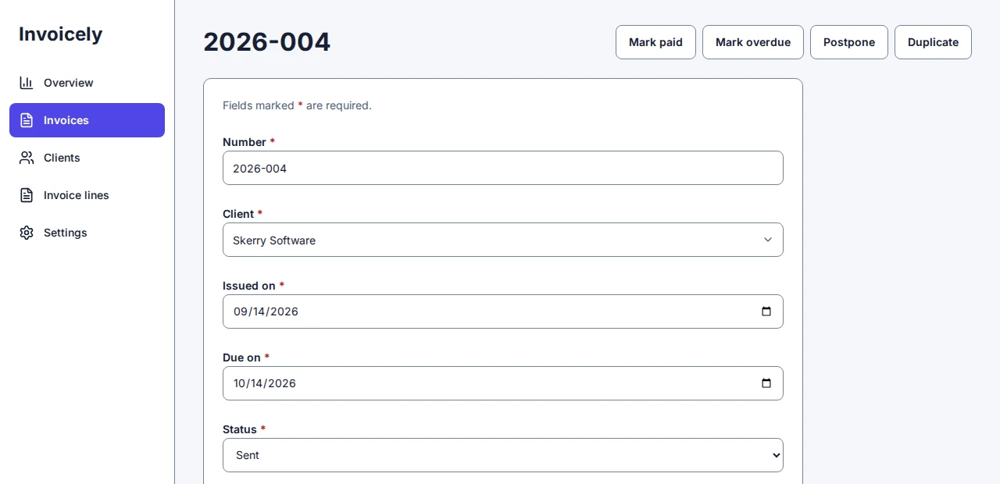
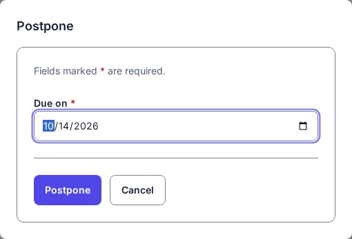

# Buttons that change a record

A standard action is a button on a record's page that moves the record on: mark an invoice sent, resolve an incident, take over a customer. It needs no code. You say which records it applies to and what it changes, and Smithable generates the button, the server function that checks who may press it, and the tests.

This page adds five actions to the invoicing starter and one to the CRM, each with the command and what it printed. Every example was run for real, and the app type-checked afterwards. Each command is one change, so `smithable undo` takes it back.

```console
$ smithable new books --starter invoicing
$ cd books
```

The starter already has two actions, **Mark sent** and **Mark paid**. You can see them in `smithable.yml`:

```yaml
actions:
  markSent:
    on: Invoice
    when: { status: draft }
    set: { status: sent }
```

## Set a field, under a condition

```console
$ smithable op addAction markOverdue --on Invoice --when status=sent --set status=overdue
Generated 100 files (5 changed, 0 removed).
Add the standard action markOverdue. Undo with: smithable undo
```

`--on` names the model, `--when` says which records the button is for, and `--set` gives the new values. The button appears on the invoice page because Invoice has one list-and-record page; on any other invoice the server refuses the action ("This cannot be done now").



A value can also be a formula, worked out on the record as it was: `--set "paidOn=TODAY()"`, or `--set "dueOn=DATEADD(dueOn, 14, \"day\")"`.

## Ask for a value

A field given no value is asked for when someone presses the button:

```console
$ smithable op addAction postpone --on Invoice --when "status=sent | overdue" --set dueOn= --set status=sent
Generated 102 files (5 changed, 0 removed).
Add the standard action postpone. Undo with: smithable undo
```

`status=sent | overdue` offers it on both states. Pressing **Postpone** opens a dialog with the field's own control, starting at the record's value:



## Add a related record

`--add` creates a record of a model that refers to this one, in the same step:

```console
$ smithable op addAction lateFee --on Invoice --when status=overdue --add "InvoiceLine.description=Late payment fee" --add InvoiceLine.unitPrice=25
Generated 104 files (5 changed, 0 removed).
Add the standard action lateFee. Undo with: smithable undo
```

Pressing **Late fee** on an overdue invoice adds a line of 25.00, and the invoice's total follows. The line's reference to its invoice is filled in, and its quantity takes its default (1). Every required field without a default must get a value, or be left empty to be asked for. Whoever presses the button also needs the right to create invoice lines.

## Copy a record, with its lists

`--copy` makes a new record from this one instead of changing it, and `--with` copies its lists too:

```console
$ smithable op addAction duplicate --on Invoice --copy status=draft --copy "issuedOn=TODAY()" --copy number= --with lines
Generated 106 files (5 changed, 0 removed).
Add the standard action duplicate. Undo with: smithable undo
```

**Duplicate** asks for the new number (an invoice's number is unique, so it cannot be copied), then opens the copy: a draft issued today, with the same client and every line. Computed fields, pictures and the owner are never copied; the copy belongs to whoever pressed the button.

## The person pressing the button

`ME()` puts in the signed-in person, for a field that refers to a user. On the CRM starter, where every customer has an account manager:

```console
$ smithable new sales --starter crm
$ cd sales
$ smithable op addAction takeOver --on Customer --set "accountManager=ME()"
Generated 88 files (5 changed, 0 removed).
Add the standard action takeOver. Undo with: smithable undo
```

**Take over** makes whoever presses it the customer's account manager. With no `--when`, it is offered on every customer.

`ME()` works in three places on an action: as a whole value in `set`, `add` or `copy` (the person pressing the button), and in `when` as `ME()` or `not ME()`, so a button shows only when it changes something. The support desk starter's **Assign to me** is both:

```yaml
assignToMe:
  on: SupportCase
  when: { assignee: not ME() }
  set: { assignee: ME() }
```

As a field's default (`default: ME()` on a reference to a user) it fills in whoever makes the record. A list's filter on the signed-in person is written `me` instead (`?assignee=me`, or `defaultFilter`), not `ME()`.

## On several records at once

Ticking rows on a list brings up a selection bar. It offers **Delete** (or **Move to trash**), **Export CSV** for just those rows, and every standard action the list's page offers that fits at least one of them, with how many it fits: **Postpone (3)**. Nothing in the spec says which actions go there: an action on the page's `actions:` is on the bar too, except copy actions (a copy is one record at a time). A field the action asks for is asked once for all the rows.

The action runs on each chosen row it fits and you may run it on, and leaves the others as they are; the bar says how many it changed and how many it skipped. If the server refuses one of the rows it should change, none of them is changed. At most a thousand rows go in one press. Custom actions are not on the bar.

## What ends up in the spec

After the four invoicing commands, `smithable.yml` has:

```yaml
actions:
  markOverdue:
    on: Invoice
    when:
      status: sent
    set:
      status: overdue
  postpone:
    on: Invoice
    when:
      status: [sent, overdue]
    set:
      dueOn:
      status: sent
  lateFee:
    on: Invoice
    when:
      status: overdue
    add:
      InvoiceLine:
        description: Late payment fee
        unitPrice: 25
  duplicate:
    on: Invoice
    copy:
      status: draft
      issuedOn: TODAY()
      number:
    with: [lines]
```

and the invoice page lists them: `actions: [markSent, markPaid, markOverdue, postpone, lateFee, duplicate]`.

## Change or remove one

`setAction` changes an action there is: its intent, the records it is for, or the values it sets. Each part you name replaces what was there, and the rest stays. On the invoicing starter:

```console
$ smithable op setAction markPaid --when "status=sent | overdue"
Change the condition of the action markPaid. Undo with: smithable undo
$ smithable op setAction markSent --intent "The invoice has gone to the customer."
Change the intent of the action markSent. Undo with: smithable undo
$ smithable op removeAction markSent
Remove the action markSent. Undo with: smithable undo
```

A bare `--when` removes the condition, so the button is offered on every record; `--intent ""` removes the intent. `removeAction` takes the action off the pages that list it and out of what an API offers by name. For anything else (another model, what it adds or copies), remove the action and add it again.

## Who may press them

An action follows its model's write access: whoever may edit the record may run it (each person on their own records, and the roles granted `write` on the model in `smithable.auth.yml`), and so may a role whose `actions` grant names it: `smithable op grant staff actions resolve` lets staff resolve incidents without letting them edit them. A custom action is run only by the roles its grant names, and by administrators.

A mail or a call to another system when a button is pressed needs no code: an [outgoing](outgoing.md) entry names the action in its `when`. When a button needs more than that (a calculation over many records, a value you type that is not a field), a custom action is code of your own: [Your own code](code.md) compares the two and writes one. The [spec reference](../spec/v0.1.md#standard-actions) has every rule of standard actions.
