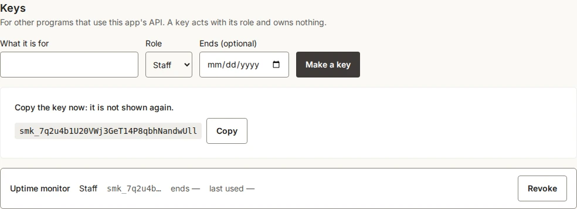

# Let other programs use your app

An app can offer its records to other programs: a monitoring tool that reports an outage, a spreadsheet that reads this month's invoices, an automation that resolves an incident. They call the app's API with a key. A key works with a role, like a person: it may do exactly what that role may, and nothing more.

This page uses the status starter, which offers its components and incidents and the **resolve** action. Every call below was made for real against a new status app, and the answers are shown as they came back (shortened where noted).

## 1. Say what the API offers

Nothing is offered until the app says so. The status starter already has this in `smithable.auth.yml`:

```yaml
api:
  models: [Component, Incident]
  actions: [resolve]
```

For your own app, the operation sets it:

```sh
smithable op setApi Component Incident --actions resolve
```

`setApi all` offers every model, also those added later (`--except` leaves some out), and `setApi` with nothing turns the API off. Offering a model is not giving it away: what a key may do with it is still its role's access.

## 2. Make a key

Keys are made in the running app, by an administrator, on the users page (the status starter's **Team** page): what the key is for, its role, and an optional end date. The key is shown once; copy it then.



Give a key the smallest role that does the job. Here **Staff** may report and resolve incidents but not manage the team. A key owns nothing it creates, can never make keys or manage people (whatever its role), and stops working when it is revoked, when its end date passes, or when the administrator who made it is removed. Every key made or revoked is in the app's activity log, by name, never the key itself.

## 3. Call the API

Send the key in the `Authorization` header. The app at `https://status.example.com` stands for yours (in development, `http://localhost:3000`).

```sh
KEY=smk_…   # the key you copied
curl -s https://status.example.com/api/v1/components?limit=2 -H "Authorization: Bearer $KEY"
```

```json
{
  "items": [
    { "id": 3, "name": "Mobile app", "status": "operational", "description": "The app for iOS and Android.", "createdAt": "2026-10-04T06:53:17.287Z", "updatedAt": "2026-10-04T06:53:17.287Z" },
    { "id": 2, "name": "Payments", "status": "degraded", "description": "Card payments at checkout.", "createdAt": "2026-10-04T06:53:17.287Z", "updatedAt": "2026-10-04T06:53:17.287Z" }
  ],
  "page": 1,
  "pages": 2,
  "total": 3
}
```

A record's lists (`incidents` on a component, `updates` on an incident) are not fields of the record: they are the other model's records that refer to it, so they are read from that side, `GET /api/v1/incidents?component=3`, a page at a time like any list. A list comes a page at a time: `limit` (at most 100) and `page`. Fields have the names they have in the spec; amounts come as decimal texts (`"12.50"`) and times as ISO texts in UTC.

**Report an incident** (a monitoring tool would do this):

```sh
curl -s -X POST https://status.example.com/api/v1/incidents \
  -H "Authorization: Bearer $KEY" -H "Content-Type: application/json" \
  -d '{"title": "Checkout is slow", "status": "investigating", "detectedAt": "2026-10-04T09:30:00Z", "component": 1}'
```

```json
{ "id": 3, "title": "Checkout is slow", "status": "investigating", "component": 1, "detectedAt": "2026-10-04T09:30:00.000Z", "resolvedAt": null, "summary": null, "createdAt": "…", "updatedAt": "…" }
```

It answers `201` with the new record. A reference (`component`) is the other record's id. `PATCH /api/v1/incidents/3` changes only the fields it is given, and `DELETE` removes the record, each as the key's role may.

**Run an action:** the same button a person presses, with the same checks.

```sh
curl -s -X POST https://status.example.com/api/v1/incidents/3/actions/resolve -H "Authorization: Bearer $KEY"
```

```json
{ "id": 3, "title": "Checkout is slow", "status": "resolved", "resolvedAt": "2026-10-04T06:54:25.856Z", "…": "…" }
```

### Without a key

What the app lets anyone read or add (`public` in `smithable.auth.yml`) can be called without a key, as a visitor. A status page that shows its incidents to everyone lets a program list and read them too: `curl -s https://status.example.com/api/v1/incidents`. Changing, deleting and actions always need a key, and so does everything when nothing is public. Without a key, the description at `/api/v1/openapi.json` and the tools at `/mcp` show only what a visitor may do.

### Filter, search, sort and add up

A list takes the list page's filters as query parameters, behind the same access:

```sh
curl -s "https://status.example.com/api/v1/incidents?status=investigating,identified" -H "Authorization: Bearer $KEY"
curl -s "https://status.example.com/api/v1/incidents?component=Payments&sort=-detectedAt" -H "Authorization: Bearer $KEY"
curl -s "https://status.example.com/api/v1/incidents?detectedAt=2026-10-01..2026-10-31&search=payment" -H "Authorization: Bearer $KEY"
```

- A field and a value: a choice field's value, or several with commas; `true` or `false` for a yes/no field; a number, an amount or a date, or a range `from..to` with either side left out (both ends included; through the tools for assistants, `over` and `under` leave the ends out); a reference by its record's id or by its title. `mine=true` keeps the caller's own records.
- `search` looks in the text fields, as the list page's search box does; `sort` names a field, with `-` in front for the highest first; `limit` and `page` as above.
- `sum=total` adds a number field up over every record that fits, not only the page given (`"sums": { "total": 1250 }`). `total` in the answer always counts every record that fits.
- An unknown field or value is refused with the ones that exist.

### As a spreadsheet

The same list as CSV: add `.csv` to its address, with the same filters, `search` and `sort`. Every record that fits comes at once (at most 10,000), no paging:

```sh
curl -s "https://status.example.com/api/v1/incidents.csv?status=resolved&sort=-detectedAt" -H "Authorization: Bearer $KEY" -o incidents.csv
```

The first line has the fields' labels as the app shows them; amounts are decimals (`12.50`), dates and times ISO, a reference is its record's title and a choice its label; pictures and documents are left out. The file is UTF-8 with a byte-order mark, so a spreadsheet reads the letters right; a cell that starts like a formula (`=`, `+`, `-`, `@`) is written with a `'` in front, so it stays text. In the app itself, "Export CSV" under a list saves the list as it is filtered, and the selection bar's Export CSV saves only the chosen records; neither needs the API.

### The trash

A model with `trash: true` keeps a deleted record for thirty days ([design/trash.md](../design/trash.md)). `DELETE /api/v1/<models>/{id}` moves it to the trash (204, as for any delete). Reading it then answers `410 Gone`, with when it was deleted, by whom, when it goes for good and where to restore it:

```sh
curl -s -X DELETE "https://crm.example.com/api/v1/customers/12" -H "Authorization: Bearer $KEY"
curl -s "https://crm.example.com/api/v1/customers/12" -H "Authorization: Bearer $KEY"
# {"status":410,"title":"This customer is in the trash.","deletedAt":"…","deletedBy":"…","removedOn":"…","restore":"/api/v1/customers/12/restore"}
curl -s -X POST "https://crm.example.com/api/v1/customers/12/restore" -H "Authorization: Bearer $KEY"
```

- `GET /api/v1/<models>?trashed=true` lists what is in the trash that the key's role may delete, each with `deletedAt`.
- `POST /api/v1/<models>/{id}/restore` takes one out and answers the record.
- `DELETE /api/v1/<models>/{id}?permanent=true` removes one in the trash for good, with its pictures and documents.
- A unique value holds among the live records only: a new record may take the value of a trashed one, and restoring that one is then refused (409).
- A record that others point to with a required reference (a customer with orders) is refused with 409 and the facts: `with` lists what points to it by kind and count, `loose` what would show no customer, `together` says whether they can all go to the trash with it (their kinds have a trash too), and `record` is its title. Then `DELETE /api/v1/<models>/{id}?together=true` moves them all, marked as one group: restoring the record restores them, and restoring one of them alone is refused (409) while the record is in the trash. Removing the record for good removes them too.
- For assistants, `find` takes `"trashed": true` and `run` has `restore<Kind>` (e.g. `restoreCustomer`) for each kind with a trash.

## 4. When the app says no

A refusal is a JSON problem (`application/problem+json`) in the app's own words, with the HTTP status that fits:

| What happened | Status | The answer |
|---|---|---|
| No key for what needs one, or a revoked, expired or wrong key | 401 | `{"status": 401, "title": "A valid key is needed: Authorization: Bearer <key>."}` |
| Resolving an incident that is already resolved | 409 | `{"status": 409, "title": "This cannot be done now."}` |
| A field the record does not have | 400 | `{"status": 400, "title": "There is no field \"colour\" to set. Fields: title, status, component, detectedAt, resolvedAt, summary."}` |
| A value that does not fit (a missing title, an unknown status) | 422 | the fields and what is wrong with each, under `errors` |
| What the key's role may not do | 403 | `{"status": 403, "title": "You are not allowed to do this."}` |
| A record that is not there, or not one the key may read | 404 | `{"status": 404, "title": "No such incident, or not one this key may read."}` |
| More than 60 calls in a minute with one key | 429 | wait, and try again |

## 5. What the API looks like, for tools

`/api/v1/openapi.json` describes every path, field and refusal in the OpenAPI 3.1 format, and needs no key to read. Tools that understand OpenAPI (Postman, n8n's HTTP Request node, an AI agent) can read it to learn what the app offers. For the status starter its paths are:

```text
/api/v1/components
/api/v1/components/{id}
/api/v1/incidents
/api/v1/incidents/{id}
/api/v1/incidents/{id}/actions/resolve
```

## 6. For AI assistants

With `assistants: true` in the `api` block (the status starter has it), the same offer is also there as tools for AI assistants, at `/mcp` in the Model Context Protocol, with the same keys. Point an assistant that speaks MCP over HTTP (Claude, ChatGPT and others) at `https://status.example.com/mcp` with the header `Authorization: Bearer <key>`.

The tools are the same seven for every app (an eighth, `delete`, where the auth file allows it), whatever its size:

| Tool | What it does |
|---|---|
| `find` | Records of one kind, with `where`, `search`, `sort`, the `fields` wanted, a `limit` (10 unless said, 50 at most) and the total, as `{ columns, rows, total }` |
| `measure` | A number worked out by the app: how many, or the sum, average, min or max of a number field (`"of": "sum total"`), optionally `by` a field or by month |
| `read` | One record with all its fields |
| `add` | Add a record |
| `change` | Change fields of a record |
| `run` | One of the app's standard actions on a record |
| `describe` | What a kind of record means: its fields, rules and actions |

With the tools comes a short summary of the app, one line per kind of record, as the server's instructions; an assistant reads it once and asks for `describe` only when it needs more. Each tool is marked as reading only or as changing what exists, so an assistant that asks its user before a risky call knows which. The key's role decides what is offered: a narrow key is not told of what it cannot reach, and without a key an assistant gets what anyone may read or add (§3). There is a `delete` tool only when the auth file says `assistants: { delete: true }`, and only for a role that may delete.

A refusal comes back as the tool's error, in the app's words, so the assistant can read it and try again:

```json
{ "content": [{ "type": "text", "text": "There is no field \"colour\" to filter by. Fields: title, status, component, detectedAt, resolvedAt, summary." }], "isError": true }
```

Each request carries one message (no batches), so every tool call counts toward the key's 60 a minute.

Each call is in the app's access log under the key (`key:<n>`) in place of a person, and every change it makes is in the activity log like anyone's.
