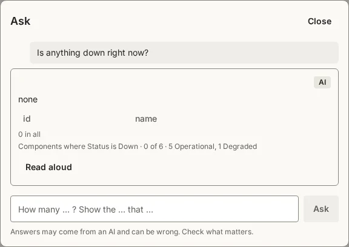
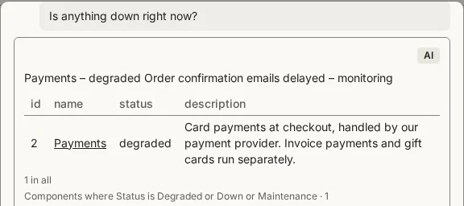

# Ask your app a question

Every app can have **Ask**: a panel where the people who use the app ask about its records in their own words. This page asks the status starter a few questions, shows the line under each answer that says what was looked up, and teaches Ask what a word means. The answers and pictures come from runs on a fresh app, with Mistral Small as the model; a model's answers vary from run to run, and this page says where they did.

To follow along on your own machine, run these in a terminal:

```sh
smithable new status-page --starter status
cd status-page
smithable studio      # opens Studio and the app in the browser
```

A starter is a ready-made app to begin from. This one is the status page of Northwind, a made-up online shop: six components (its website, payments, mobile app and so on), five of them operational and Payments degraded, with incidents and planned maintenance. The starter already turns Ask on for everyone who signs in. On your own machine the app's sign-in page offers **Sign in as admin**. Ask reads only the records the person asking may read. On this starter it only answers; an app can also let it propose changes, each made only once the person confirms it.

Many questions are read by rules in the app itself, with no AI and at no cost. For the others, the app needs an AI model from its host: on smithable.ai that is set up for you; on your own machine see [The app's assistant](../ai.md#the-apps-assistant-ask) in AI setup. Each answer is marked **From your records** (the rules read it) or **AI** (a model chose what to look up).

## Each answer says what it looked up

Open **Ask** in the app's header and ask *"Is anything down right now?"*:



The answer, marked **AI**, is "none". The model chose what to look up; the small line under the answer is the app writing out exactly that, in the app's own words: **Components where Status is Down · 0 of 6**. So the model took "down" to mean the status *down*, and no component has it.

When a question about a choice (a field with a fixed list of values, like Status) finds nothing, the line ends with how all the records split on that field, counted by the app: **5 Operational, 1 Degraded**. The "none" now reads as "none with that exact value", and Payments, which is degraded, is right there.

In other runs the model read the same question as *down or degraded* and answered Payments, with **Components where Status is Down or Degraded · 1** under it. The line is how you tell which reading you got. Click a row's name in an answer to open its record.

The rules need no model for a question worded closely enough: *"Which components have the status down?"* is answered **From your records**, with the same line and split as above. A count gets a line too: *"How many incidents are being monitored?"* answers 2, with **Count of incidents where Status is Monitoring** under it.

## Teach Ask what a word means

"Down" can mean the status *down* or anything that isn't working. When a word can be read two ways, say what it means in the field's description:

```console
$ smithable op setMeaning Component.status --description "In a question, down or not working means any status but operational, not only the value down."
Generated 164 files (2 changed, 0 removed).
Explained what Component.status means to the assistant. Undo with: smithable undo
```

Like any change, it is kept in the app's spec, `smithable.yml`, next to the field, and `smithable undo` takes it back:

```yaml
      status:
        type: operational | degraded | down | maintenance
        description: In a question, down or not working means any status but operational, not only the value down.
```

Keep a choice field's description to 120 characters or fewer: one that short is in the summary Ask reads before it looks anything up. A longer one is read only when the model asks for the field's details, which it may not do. A description is for Ask and for developers; nobody using the app sees it.

Ask the same question again:



The line now reads **Components where Status is Degraded or Down or Maintenance · 1**: every status but operational, as the description says, so a component under maintenance would be counted too. In this run Ask also listed the incidents still open, the reason the answer names an order-mail delay. A description makes the intended reading much more likely, not certain: in one run the model looked at all six components and picked Payments itself, and its line said so (**Components · 6**).

`setMeaning` also explains a kind of record (`Component`), an action, a page or the app itself, and `--intent` says what something is for. `--description ""` removes a description.

## Related

- [The app's assistant](../ai.md#the-apps-assistant-ask): the model Ask uses, on smithable.ai and on your own machine.
- [An app for programs and assistants](assistants.md): the same records offered to an AI assistant such as Claude Code, with a key.
- [Change an app without writing code](change.md): more changes to the status starter, one command each.
