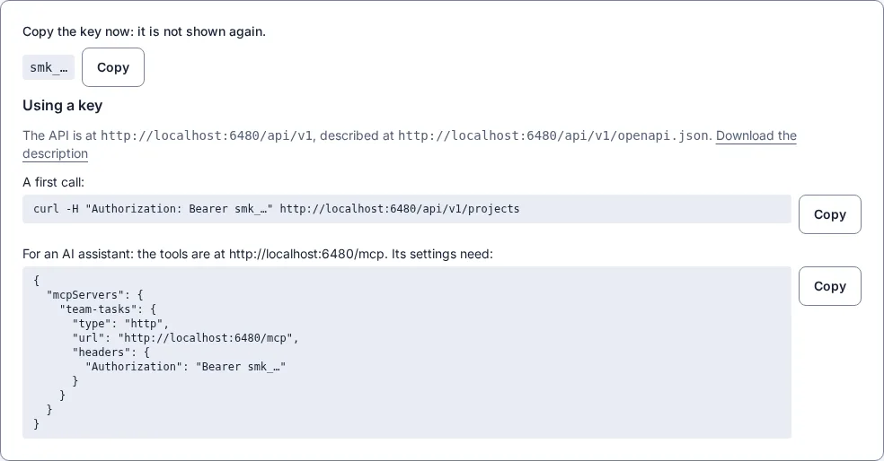

# An app for programs and assistants

Some apps are mostly used by other programs: a backend for a phone app, a place where an AI assistant keeps what it needs to remember. Such an app needs no landing page and no screens of its own, only a page for the team that runs it, keys, and the rules that say who may do what. Those rules hold for every caller, person or program.

This page makes one from the `api` starter, Team Tasks: projects, tasks and notes that an AI assistant keeps for a small team. Every command and answer below was run for real on a new app, and the answers are shown as they came back (shortened where noted).

## 1. Make it

```sh
smithable new my-tasks --starter api
cd my-tasks
smithable run
```

The app has two pages, both behind sign-in: **Team**, where an administrator invites people and makes keys, and **Admin**, which shows every record. Nothing is public. Its roles are in `smithable.auth.yml`:

```yaml
roles:
  member:
    description: A team member who works with the tasks and notes.
  assistant:
    description: "The AI assistant's key: reads everything, adds and changes tasks and notes, never deletes."
api:
  models: all
  actions: all
  assistants: true
```

`api` offers every model and the standard actions (here **complete** and **reopen** a task) to programs, and `assistants: true` offers the same as tools for AI assistants. What a caller may do is still its role's access, granted in `smithable.auth.yml`: the assistant may add and change tasks and notes, and may delete nothing.

## 2. Make a key

Sign in as the administrator and open **Team**. Under **Keys**, say what the key is for ("Claude Code") and make it. In an app with an `assistant` role, that is the role a key starts with. The key is shown once, with what a program needs to use it:



Copy the key then; afterwards only its first characters are shown. It stops working when it is revoked, when its end date passes, or when the administrator who made it is removed.

## 3. The first calls

`https://tasks.example.com` stands for your app (in development, `http://localhost:3000`).

```sh
KEY=smk_…   # the key you copied
curl -s "https://tasks.example.com/api/v1/tasks?status=todo&limit=3" -H "Authorization: Bearer $KEY"
```

```json
{
  "items": [
    { "id": 7, "title": "Order boxes", "project": 3, "status": "todo", "dueDate": null, "…": "…" },
    { "id": 5, "title": "Draft the newsletter", "project": 2, "status": "todo", "dueDate": "2026-10-10", "…": "…" },
    { "id": 3, "title": "Check the site on a phone", "project": 1, "status": "todo", "dueDate": "2026-10-14", "…": "…" }
  ],
  "page": 1,
  "pages": 1,
  "total": 3
}
```

A field in the address filters the list (`status=todo`). Adding a task, then completing it with the standard action:

```sh
curl -s -X POST https://tasks.example.com/api/v1/tasks \
  -H "Authorization: Bearer $KEY" -H "Content-Type: application/json" \
  -d '{"title": "Label the boxes", "project": 3, "dueDate": "2026-10-25"}'
curl -s -X POST https://tasks.example.com/api/v1/tasks/8/actions/complete -H "Authorization: Bearer $KEY"
```

```json
{ "id": 8, "title": "Label the boxes", "project": 3, "status": "todo", "dueDate": "2026-10-25", "…": "…" }
{ "id": 8, "title": "Label the boxes", "project": 3, "status": "done", "dueDate": "2026-10-25", "…": "…" }
```

What the role may not do is refused in the app's words. Deleting is not the assistant's:

```sh
curl -s -X DELETE https://tasks.example.com/api/v1/tasks/8 -H "Authorization: Bearer $KEY"
```

```json
{ "status": 403, "title": "You are not allowed to do this." }
```

Without a key nothing answers, since nothing in this app is public: `{"status": 401, "title": "A valid key is needed: Authorization: Bearer <key>."}`. [Let other programs use your app](api.md) has every call and refusal of the API.

## 4. Connect an assistant

The same key opens the app's tools for AI assistants at `/mcp`, in the Model Context Protocol. For Claude Code:

```sh
claude mcp add --transport http team-tasks https://tasks.example.com/mcp \
  --header "Authorization: Bearer $KEY"
```

Other assistants that speak MCP over HTTP take the settings shown with the key (step 2). The app offers seven tools, the same in every app: **find** (with a condition, a search, a sort), **measure** (count, sum, average, smallest or largest, split by a field), **read**, **add**, **change**, **run** (an action) and **describe**. With them comes a short summary of the app, which the assistant reads first:

```text
Team Tasks: Tasks and notes, grouped in projects, that an AI assistant keeps for a small team.
Project (projects): name*, description. Title: name.
Task (tasks): title*, project* -> Project, status* (todo | doing | done), dueDate (date), assignee -> User, details. Title: title.
Note (notes): title*, project* -> Project, body. Title: title.
Actions: complete (Task, when status is todo or doing), reopen (Task, when status is done).
* required. You act as someone with the role assistant.
Answer with what a tool returned; a number, a name or "none" you did not get from a tool is not an answer.
```

Then ask it as you would ask a person. "What is still to do on the office move, and when is it due?"

> Two tasks are still open on the **Office move** project. The move itself is planned for **November**, but no exact date is recorded.
>
> | Task | Status | Due | Assignee |
> |---|---|---|---|
> | Book the movers | In progress | **2026-10-20** | Nobody |
> | Order boxes | Not started | No date | Nobody |
>
> The project also has a note saying the new office's door code changes on the first of every month and isn't written down. You'll need to ask Marcus for it.

It found the project, its open tasks and the note that belongs to it. "Add a task to the office move: book a van for moving day, due 2026-10-31."

> I added "Book a van for moving day" to the Office move project. It's due 2026-10-31, its status is todo, and nobody is assigned to it yet.

"How many tasks are done, in each project?" is counted by the app (`measure`, split by project), not by the assistant adding up rows:

> | Project | Done tasks |
> |---|---|
> | Website relaunch | 1 |
> | Autumn newsletter | 1 |
> | Office move | 1 |

The tools leave little to guess. A question that names something the app does not have (a status no task has, a project by a name nothing has, a search nothing fits) gets none with a note of what there is instead, the nearest names first; `measure` split by a field says when the top is shared, so one is not given as the winner; `read` gives a record with its lists, twenty of each (a project with its tasks); and a change answers with the record as it is now.

Each answer took Claude Code four or five steps and 9 to 12 cents of its own model, paid by whoever runs the assistant; the app's part is the same as a plain call. Each call is in the app's access log under the key, and every change it makes is in the activity log like anyone's (Admin → Activity).

## 5. Try it in the app

A test bench on the administrator's pages, to try the tools as an assistant with a chosen role before connecting one, is coming (docs/design/api-only.md, decision 4). Until then, Claude Code as above, or any MCP client with the settings from step 2, is the way to try it.

## For your own app

An app with pages can be used by programs and assistants too: `smithable op setApi all --assistants true` offers every model, and a key is made on its users page the same way. Give a key the smallest role that does the job, and a role of its own (like `assistant` here) when what a program may do differs from what people may.
