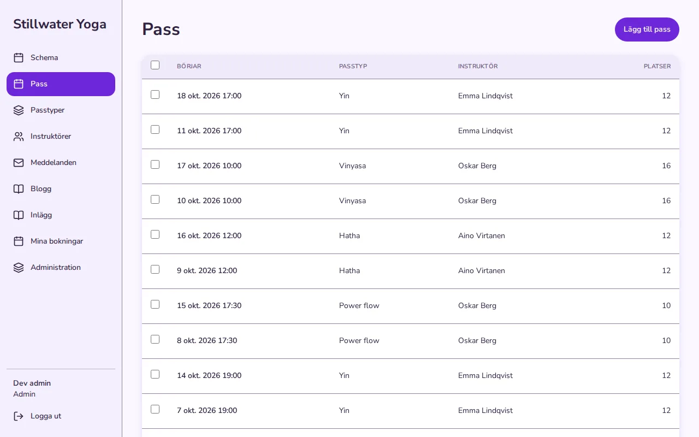

# An app in another language

An app has one language: the one the people who use it read. You write your own texts in that language, and the content file says which language it is. Smithable then gives the app's own words in that language too: Save and Cancel, the sign-in page and its mails, empty lists, confirmations, the filters, the users page. English and Swedish are there today; another language is one file of words, added when someone asks for it.

This page turns the booking starter into a Swedish app. Every command below was run for real on a new booking app, and the answers are shown as they came back.

## 1. Set the language

```sh
smithable op setLanguage sv
```

```text
smithable.content.yml:5:3  warning  ClassType: the plural would be made by an English rule ("Class types"); give it a pluralLabel.
smithable.content.yml:5:3  warning  Instructor: the plural would be made by an English rule ("Instructors"); give it a pluralLabel.
…
Generated 146 files (2 changed, 0 removed).
Set the app's language to sv. Undo with: smithable undo
```

The operation adds one line to `smithable.content.yml`:

```yaml
language: sv
```

The app's own words now come from its Swedish file, and the page says `lang="sv"`. Nothing in `smithable.yml` changes: the language is about what people read, not what the app does. A language the app kit has no words in is refused, with the ones it has:

```text
setLanguage: "language" must be one of "en", "sv".
```

## 2. Name the records

The warnings ask for something only you can give: what one record and several records are called. The starter's names are English, and an English rule makes the plural from them ("Kund" would become "Kunds"). `nameRecords` gives both:

```sh
smithable op nameRecords ClassType Passtyp Passtyper
smithable op nameRecords Instructor Instruktör Instruktörer
smithable op nameRecords Session Pass Pass
smithable op nameRecords Booking Bokning Bokningar
smithable op nameRecords Post Inlägg Inlägg
smithable op nameRecords Message Meddelande Meddelanden
```

```text
Call ClassType records "Passtyp" and "Passtyper". Undo with: smithable undo
…
```

Each writes `label` and `pluralLabel` into the content file, and renames the list pages that carried the old name. `smithable validate` now says only `smithable.yml is valid: 6 models, 10 pages.`

The app builds its phrases around these names so that they read right in Swedish whatever the word's gender: **Lägg till pass**, **Inga bokningar ännu**.

## 3. Translate your own texts

Your own texts are never translated for you: the app shows them as you wrote them. The starter's own texts are still in English, so they are what is left to change. Click a text in Studio's preview and type, or set it with `setText` and the text's place in the content file:

```sh
smithable op setText "Boka en matta" models Booking reserve book
smithable op setText "Inga mattor kvar" models Booking reserve full
smithable op setText "Schema" pages schedule title
smithable op setText "En stund bara för dig." pages schedule subtitle
smithable op setText "Börjar" models Session fields startsAt label
smithable op setText "Platser" models Session fields capacity label
smithable op setText "Mina bokningar" pages my-bookings title
```

```text
Change the text models.Booking.reserve.book to "Boka en matta". Undo with: smithable undo
…
```

A field's label and a page's title that you never wrote come from their names in `smithable.yml` (`startsAt` reads "Starts at"), so they are English too until you give them a text. Dates and times are shown the way the reader's browser writes them.



## 4. What stays English, on purpose

- **The API's refusals and the assistant's tool messages.** Programs and AI models read them, not people, and their field names and codes are the same in every app.
- **The operator's logs**, for whoever runs the app.
- **Studio and the Builder**: they are your tools, not your app's.
- **A note shown only in development**: a sign-in provider whose keys are missing points to the README.

## 5. Back to English

`smithable undo` takes back the last change, as always, and `smithable op setLanguage en` removes the line: the app's own words are English again, and your names and texts stay as they are.
