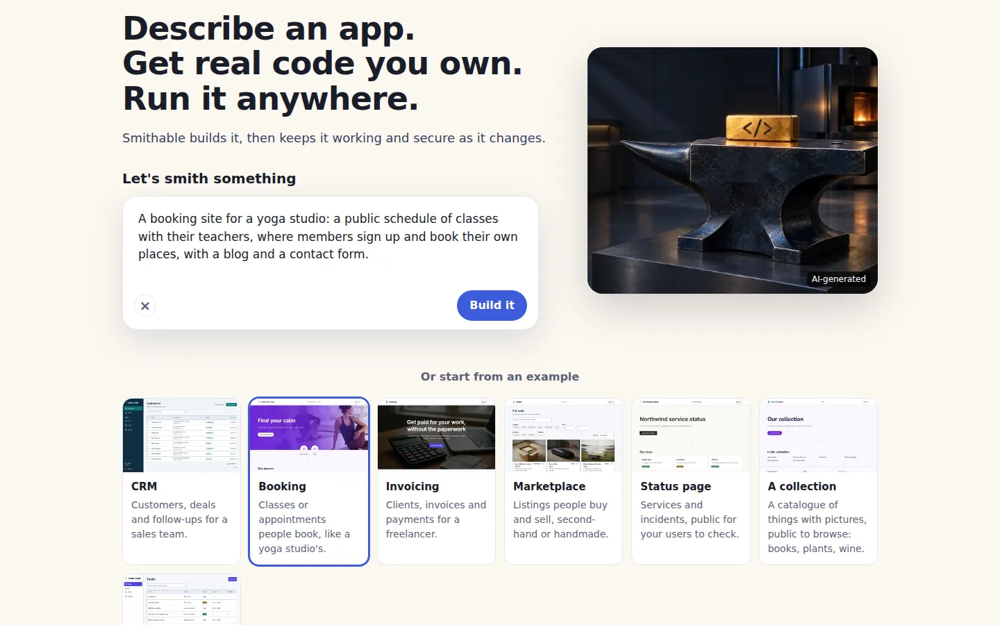
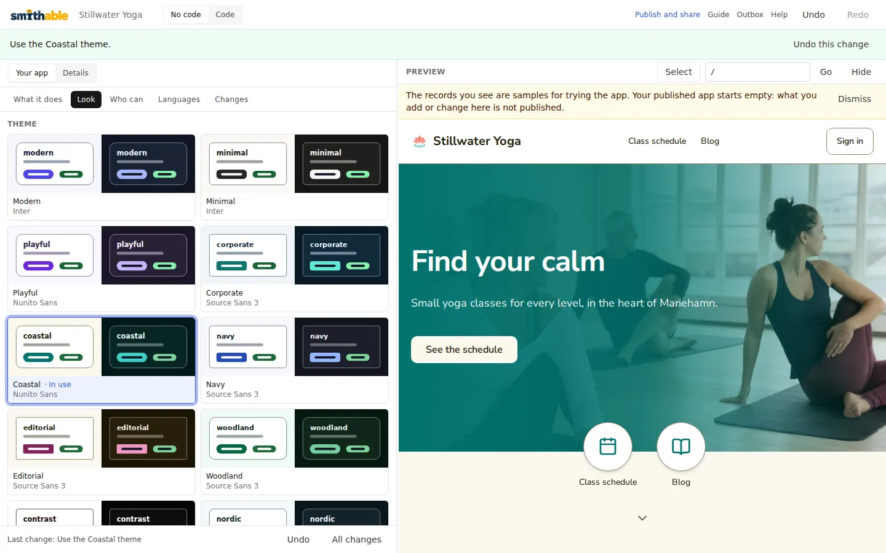
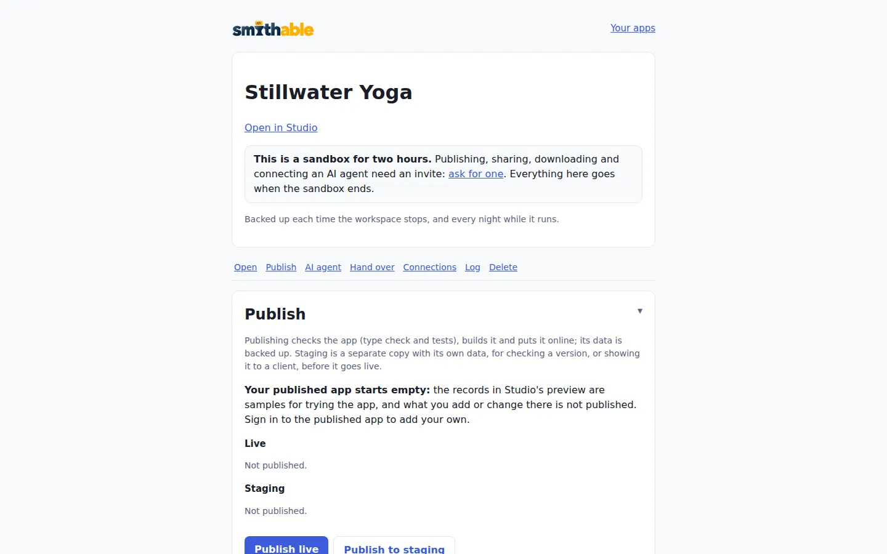

# Getting started on smithable.ai

Nothing to install: the app and its editor run in your browser, on our servers. A sandbox needs no sign-up and lasts two hours. To keep apps, publish them and hand them over, you need an invite to the private beta. To run everything on your own machine instead, see [Getting started on your own machine](start-local.md).

## Try it in a sandbox

On [smithable.ai](https://smithable.ai), write what you want in the box under "Let's smith something", or pick a card under "Or start from an example", which fills in the box for you. Then press **Build it**.



A starter is ready in a few seconds, because no model is needed for it. Something you wrote yourself is drafted from your words first; see [AI setup](../ai.md) for how that works.

The sandbox is yours for two hours from the moment it starts. Then it is removed with everything in it. One visitor can start three sandboxes an hour.

## Change it in the browser

The sandbox opens Studio, the same editor `smithable studio` opens on your own machine. Smith, Studio's assistant, is on the left, with the app's preview beside him. First he presents the app, part by part: what it is for, its pages, who can do what. If you started from your own words rather than an example, the draft had to assume a few things, and he asks about each at its part: keep it, choose another answer, or leave it open; his suggestions offer what you left open again later. Then he shows you round Studio; **Guide** in the top bar shows the tour again.

Tell Smith what to change in your own words, or ask him how the app works. He shows a change in plain words and makes it when you confirm. To change the app by hand, open **No code** in the top bar: **Behavior**, **Look**, **Who can** and **Content**, in plain words and forms. **Code** beside it has the app's files themselves (the [spec](../spec/v0.1.md)), to edit by hand. Smith stays on the left either way. Every change is an operation, so **Undo** takes it back.

Here, **Look** and the Coastal theme gave the Booking example's app (Stillwater Yoga) new colors and a new font. The line at the top says what changed, and **Undo this change** is right beside it:



The records in the preview are samples for trying the app. The published app starts empty.

## Publish and share

**Publish and share** in Studio's header opens the app's page. In a sandbox the page says so up front: the sandbox lasts two hours, publishing, sharing, downloading and connecting an AI agent need an invite, and everything goes when the sandbox ends. [Ask for an invite](https://smithable.ai/invite-request) if you want to keep what you build.



An invite comes by mail as a link. Opening it makes your account, with Google or with your name. **Your apps** lists your apps and keeps them until you delete them. **New app** starts another one, from a description or an example, just like the start page.

The app's page has these sections:

- **Publish.** **Publish live** checks the app (type check and tests), builds it and puts it online with backups. Its address is `a-<app id>.smithable.app`. **Publish to staging** makes a separate copy with its own data, for checking a version or showing it to a client first. A problem the check finds, such as an administrator address nobody can receive mail at, is listed before you publish.
- **Your own domain.** Once the app is live, enter the domain and save; the section then shows an A record and a TXT record to add at your domain's provider. The certificate is made at the first visit.
- **Mail.** The service sends the published app's mail, its sign-in codes included, so you don't need mail settings. The app's page tells you if mail is paused or addresses bounce.
- **Sign in with Google.** Under Connections, for a "Continue with Google" button beside the code by email. [Sign in with Google](google-sign-in.md) shows how.

## Where it runs

Every app is hosted in Sweden, with its backups in the same region, within the beta's [limits](limits.md). An account is global unless its owner makes it an EU account: **Region** on your account page shows the current region and changes it. An EU app's AI requests stay in the EU too, unless its level is Relaxed; a Relaxed or a global app's requests may go to the USA ([AI setup](../ai.md#the-apps-assistant-ask)). The [questions and answers](why.md#where-does-my-data-live) say more.

## Take it with you

**Hand it over** on the app's page has two ways out:

- **Download everything (.zip)**: the code with its whole history, the data (also as spreadsheet files), the uploads and a README, ready in under a minute.
- **Make a transfer link**: a one-time link, valid for seven days, that moves the app, with its published version and its data, to another account.

The download holds the app's code with its whole history (a Git bundle) and its data. Its README has the commands that make it an ordinary Smithable project again, once Node 24, pnpm and the Smithable CLI are [installed](start-local.md) (`stillwater` is any folder name):

```sh
git clone project.bundle stillwater
cp -r data stillwater/
cd stillwater
pnpm install
smithable studio
```

Then every command in [Getting started on your own machine](start-local.md) works on it. The app also runs without Smithable (`pnpm dev`), and `smithable detach` removes what only Smithable uses. [Leaving, tried out](leave.md) does it with a sample download: run with Docker, changed, tested, and what it needs set up of its own.
