# Starters

A starter is a complete app to begin from: its spec, real sample records and pictures, and the generated code. Make one with `smithable new <folder> --starter <name>`, change it with operations or in your own words, or start it without the sample records with `--no-sample-data`. The pictures below are the starters as `smithable new` makes them, at desktop width. Each starter also has a page of its own on smithable.ai; all seven are at [smithable.ai/starters](https://smithable.ai/starters).

## CRM

*Customers, deals and follow-ups for a sales team.*

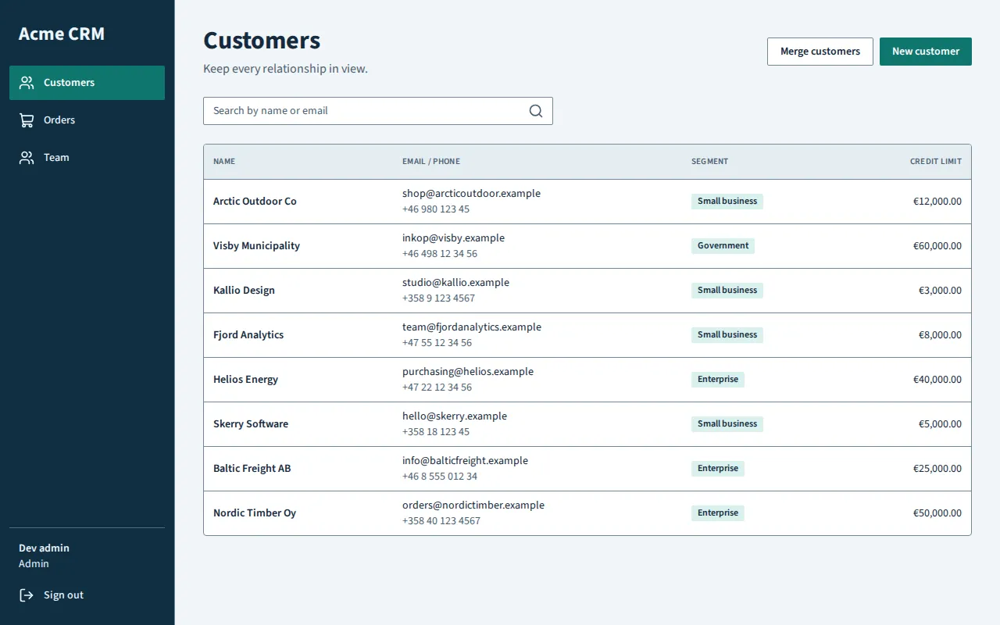
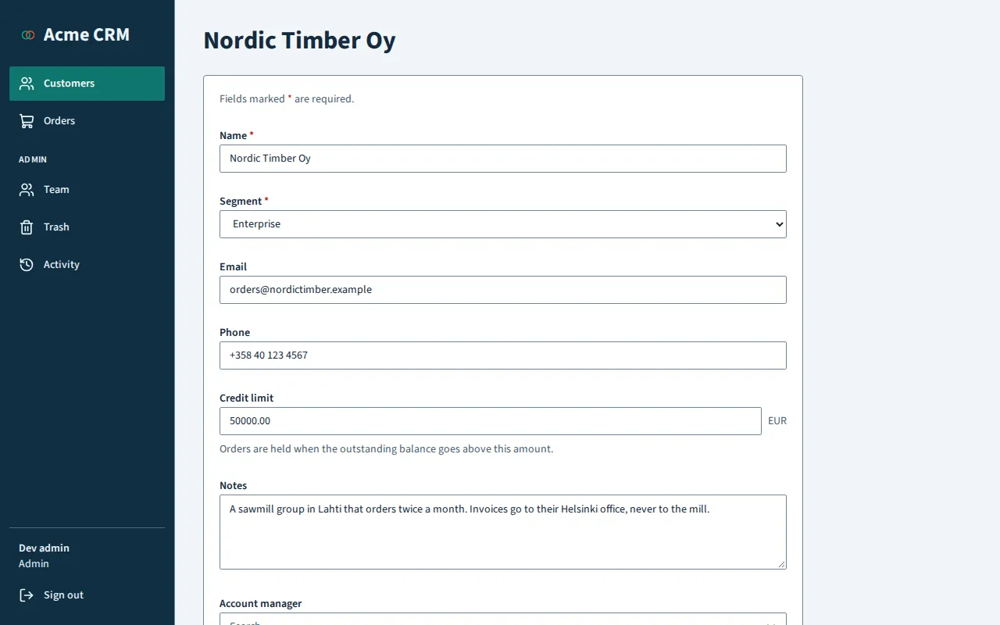

For a sales team that keeps track of customers and their orders. It shows records that point at each other (an order's customer, a customer's orders), a formula that works out the shipping cost, a status for each order, an account manager who owns each customer, two roles with different rights, invitations to the team, and a custom action with its own code (merging two customers).

```sh
smithable new my-crm --starter crm
```

See it live: coming soon. Its page on smithable.ai: [smithable.ai/starters/crm](https://smithable.ai/starters/crm).

## Booking

*Classes or appointments people book, like a yoga studio's.*

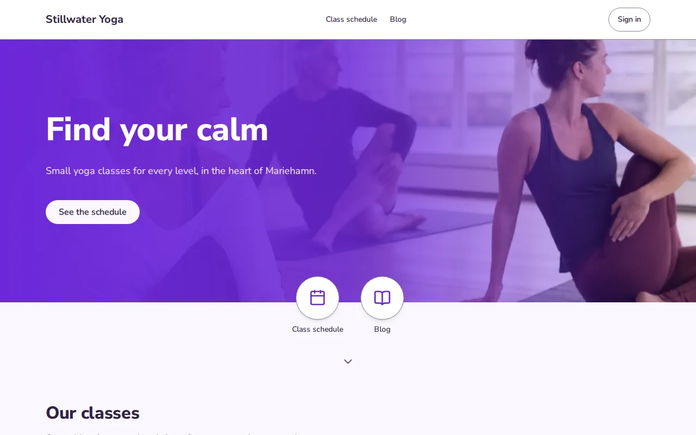
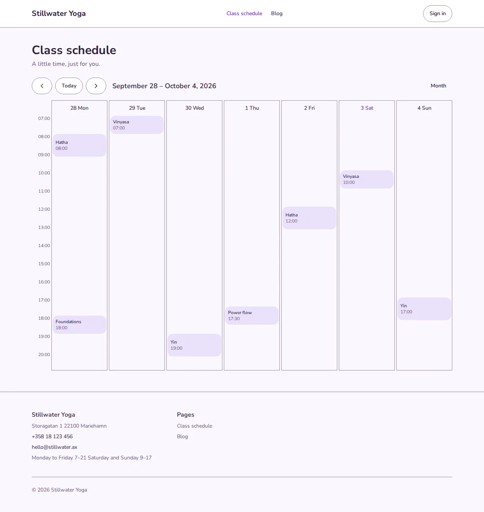

For a studio, a teacher or anyone who sells places in classes or sessions. Stillwater Yoga has a landing page with a cover picture, a gallery, a calculator ("would a monthly pass pay off?") and a contact form; a weekly class schedule that visitors can read; bookings with a capacity, so a full class takes no more; instructors with portraits; and a blog in Markdown.

```sh
smithable new my-studio --starter booking
```

See it live: coming soon. Its page on smithable.ai: [smithable.ai/starters/booking](https://smithable.ai/starters/booking).

## Invoicing

*Clients, invoices and payments for a freelancer.*

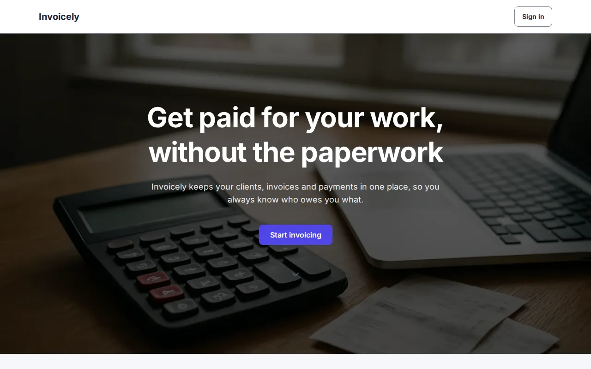
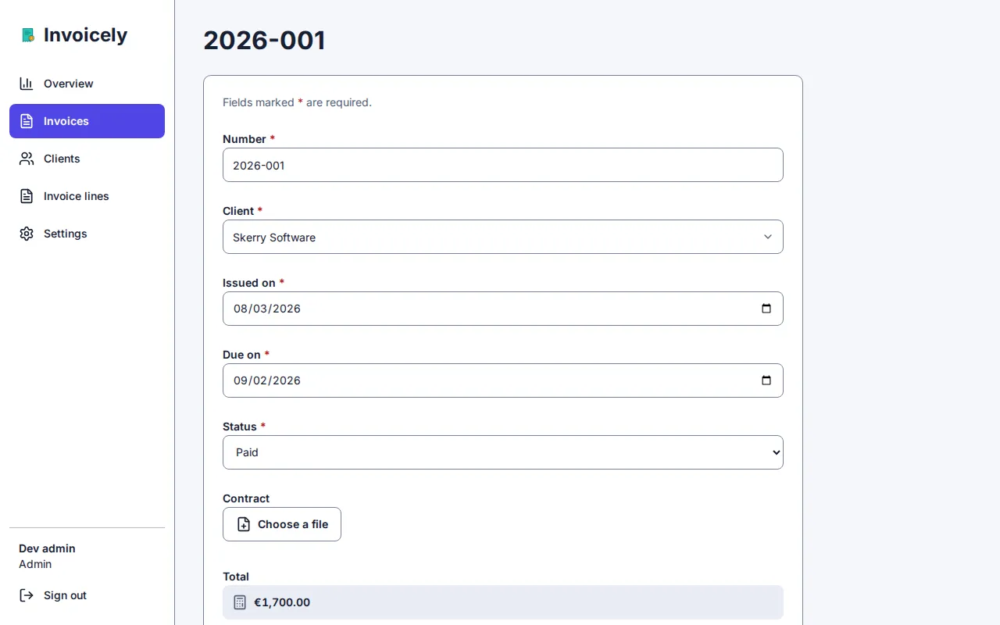

For a freelancer who sends invoices. Each user sees only their own clients and invoices; an invoice's lines work out their amounts and the invoice its total; the due date follows from the issue date; an overview page sums up what is owed; and a settings page holds the business details printed on every invoice.

```sh
smithable new my-invoices --starter invoicing
```

See it live: coming soon. Its page on smithable.ai: [smithable.ai/starters/invoicing](https://smithable.ai/starters/invoicing).

## Marketplace

*Listings people buy and sell, second-hand or handmade.*


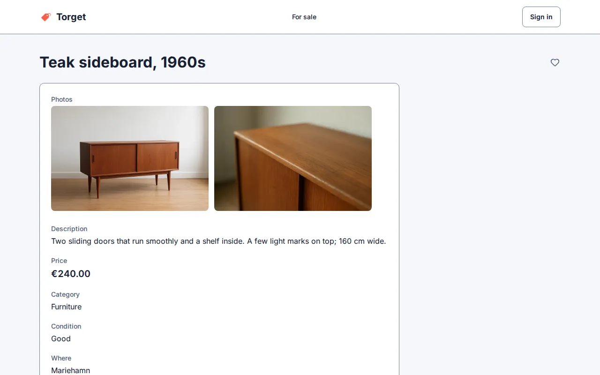

For a place where people sell or give away things to each other. Torget's start page is the catalog, with search, filters (category, price, condition) and sorting; each item has several photos; members save the ones they like, keep a page of their own items, and send a seller a message from the item's page. A seller's new item appears once an admin has approved its photos on the Review page.

```sh
smithable new my-market --starter marketplace
```

See it live: coming soon. Its page on smithable.ai: [smithable.ai/starters/marketplace](https://smithable.ai/starters/marketplace).

## Status page

*Services and incidents, public for your users to check.*

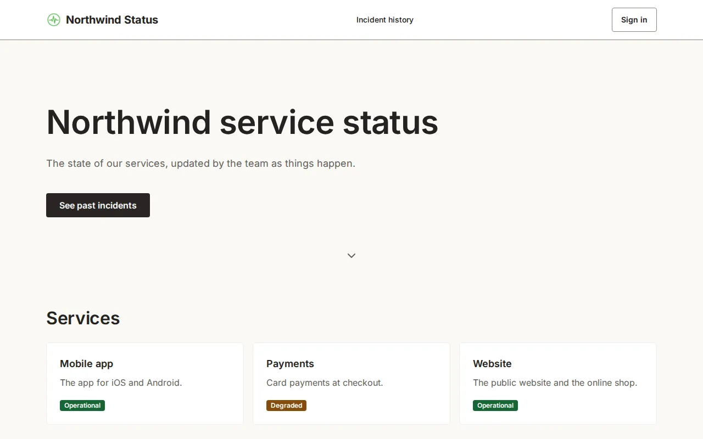
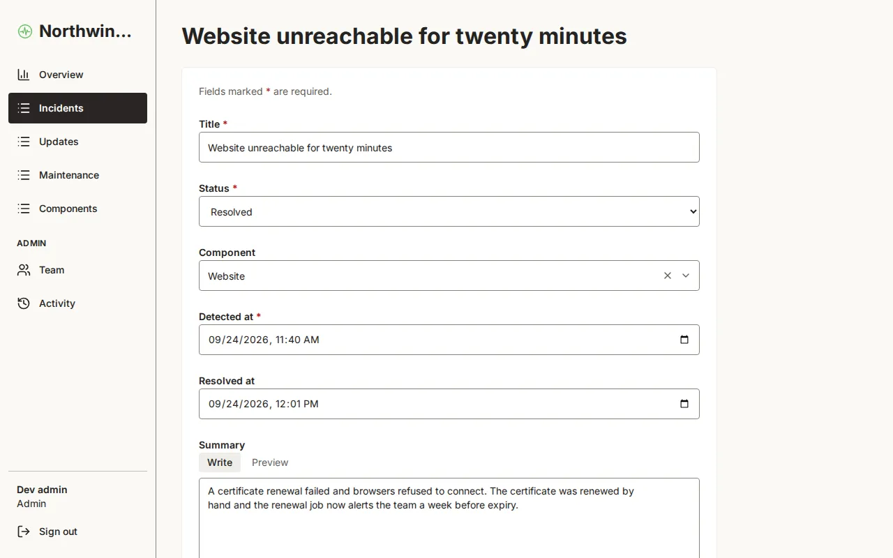

For a team that tells its users how its services are doing. Northwind Status shows each service's state on a public page with what is going on now, planned maintenance and recently resolved incidents; an incident moves through investigating, identified, monitoring and resolved, with a timeline of updates; and the incident history is public too. Under the services, a section of the starter's own code shows the last 90 days of each one, a bar a day, worked out from the incidents (`src/custom/sections/Uptime.tsx`, with its test): an example of a section no pattern covers. Uptime monitoring is not built in: the team opens the incidents.

```sh
smithable new my-status --starter status
```

See it live: coming soon. Its page on smithable.ai: [smithable.ai/starters/status](https://smithable.ai/starters/status).

## Support desk

*Requests that come in by mail, answered by your team in a conversation.*

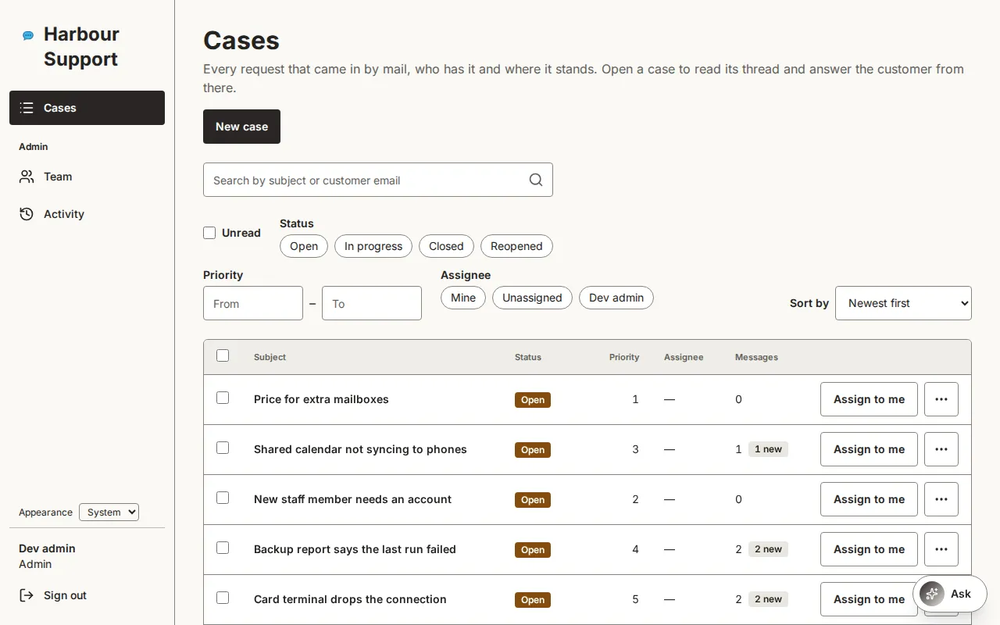
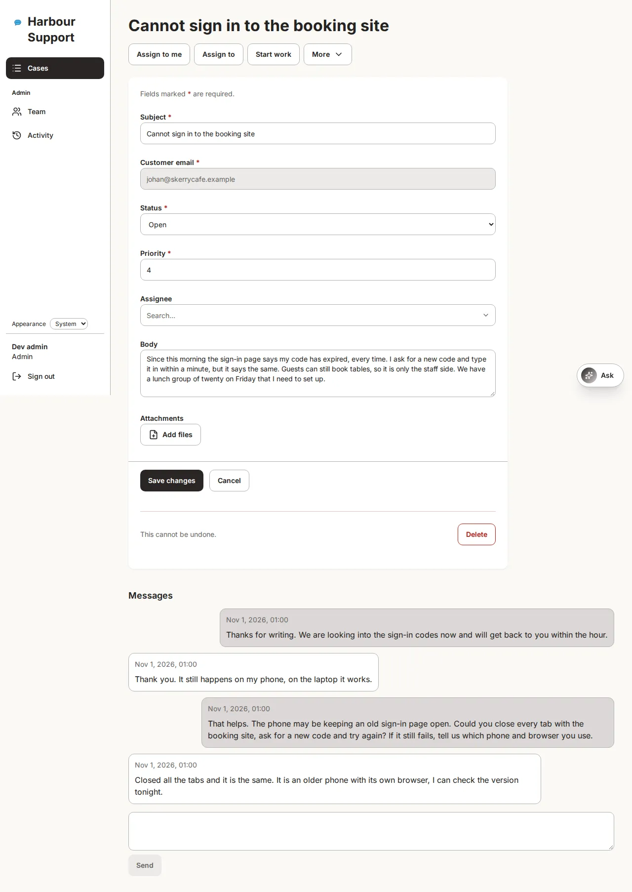

For a small team that answers customers by mail. A mail to the support address becomes a case; the acknowledgement carries the case's number in its subject, and a reply to any of the case's mails joins it as a message, found by its headers or by that number. On a case's page its messages read as a conversation, the customer's on one side and the team's on the other, with a reply box that mails the customer from the page; the cases list counts each case's messages and marks those you have not read, with an Unread filter. A case has a priority from 1 to 5 and needs an assignee once it is in progress or closed; agents take a case or give it to a colleague, and the customer's address stays as it came. The mailbox is a setting: on smithable.ai you connect one, self-hosted your own receiver posts to `/incoming/support`.

```sh
smithable new my-support --starter support
```

See it live: coming soon. Its page on smithable.ai: [smithable.ai/starters/support](https://smithable.ai/starters/support).

## A collection

*A catalogue of things with pictures, public to browse: books, plants, wine.*

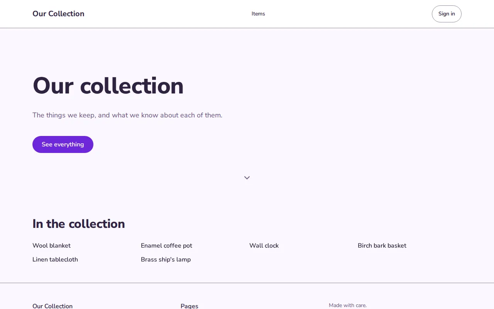
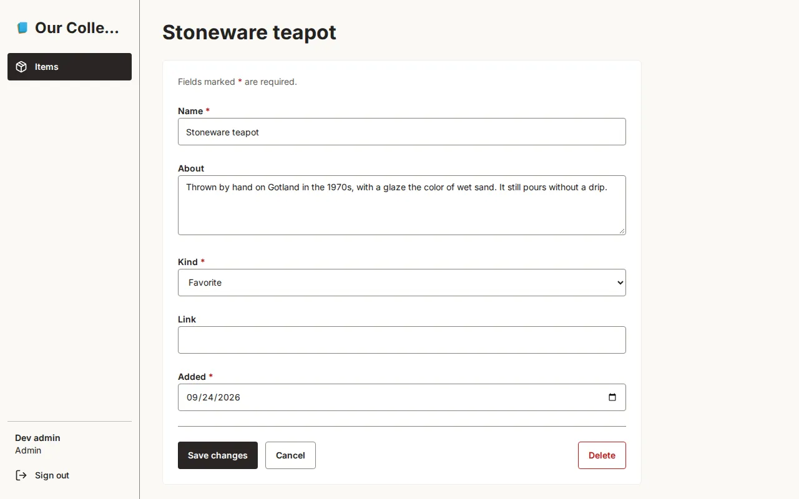

The smallest starter: one kind of record and a public page that lists them. A good beginning for a collection, an inventory or anything you simply want to keep and show, and the quickest one to read if you want to see how a spec works.

```sh
smithable new my-collection --starter records
```

See it live: coming soon. Its page on smithable.ai: [smithable.ai/starters/records](https://smithable.ai/starters/records).

## An API

*Records behind an API, for programs and AI assistants. No public pages.*

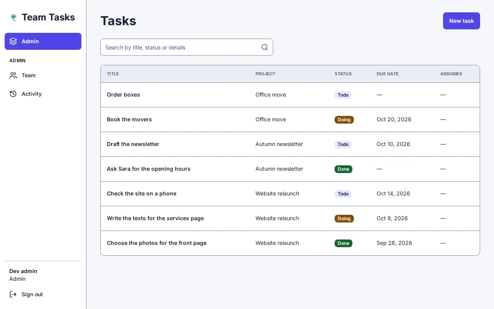
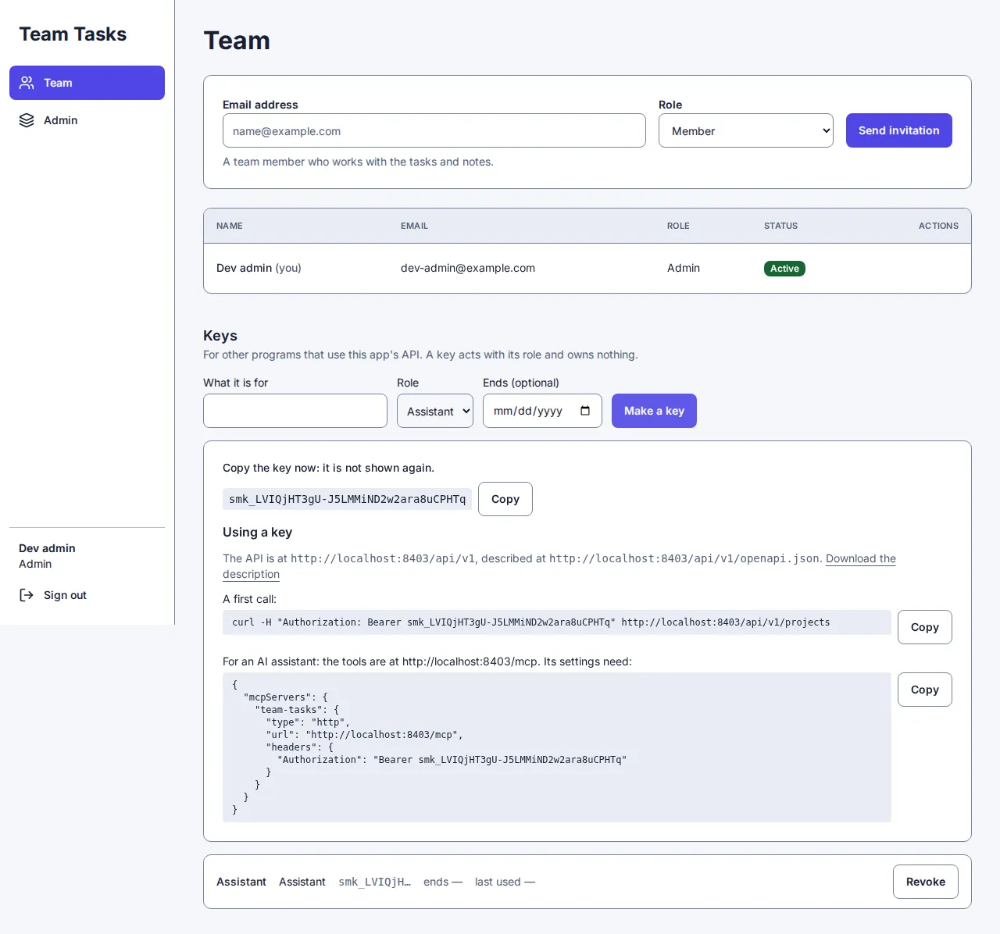

An app for programs and AI assistants, with no pages of its own: projects, tasks with a status, a due date and who they are for, and notes, all reached through the API and the tools for assistants at `/mcp`. Its only screens are the team page, where an administrator makes keys, and a data page for the team. A key with the `assistant` role reads everything, adds and changes tasks and notes, and deletes nothing; complete and reopen are standard actions. Nothing is public: an assistant's memory is private.

```sh
smithable new my-tasks --starter api
```

See it live: coming soon. Its page on smithable.ai: [smithable.ai/starters/api](https://smithable.ai/starters/api).
